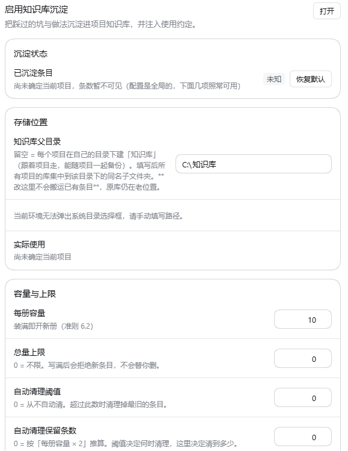

# dsh-knowledge —— 项目知识库

> **English summary** — A per-project knowledge base for DSH (DeepSeek Harness): the agent records the pitfalls it hits under `避错/` and the reusable practices under `方法/`, with monotonic entry IDs and auto-maintained indexes.
> **Install:** `dsh plugin add @moyu-cn/dsh-knowledge` (recommended, from npm). The tarball and from-source alternatives are in the 安装 / Install section below. Then restart DSH for the host half and reload the page for the client half.
> **Highlights:** 8 agent tools (`kb_search` / `kb_add` / `kb_list` / `kb_get` / `kb_guide` / `kb_remove` / `kb_prune` / `kb_init`), a same-origin HTTP API, a right-pane browser and a settings row.
> **Language:** the settings UI follows the host language setting — Chinese and English dictionaries are both built in. **Model-facing prompts stay in Chinese** by design.
> **License:** MIT.

让智能体把**踩过的坑**与**可复用的做法**沉淀进项目知识库，并在后续会话里自动受益。

一句话原理：可复用的做法写进 `方法/`，踩过的坑写进 `避错/`；**编号只增不改**（引用才靠得住），分册与索引由工具自动维护。

## 安装 / Install

**✅ 推荐 / Recommended —— 从 npm 安装（用包名，不要手抄 tarball 地址）：**

```bash
dsh plugin add @moyu-cn/dsh-knowledge
```

*装完按提示重启 DSH；客户端那一半刷新页面即可生效。*
*Restart DSH when prompted; reload the page for the client half.*

### 备选方式 / Alternatives

**① tarball —— 直接装打包文件 / install the packed tarball**

```bash
dsh plugin add https://registry.npmjs.org/@moyu-cn/dsh-knowledge/-/dsh-knowledge-0.1.0.tgz
```

**② 源码 —— clone 后把本地目录链接进 profile / from source: clone and link the folder**

```bash
git clone https://github.com/MoYu-CN/dsh-knowledge.git
dsh plugin add "link:<你的目录>/dsh-knowledge"
```

`link:` 不拷贝、直接软链，改代码立刻生效 —— 适合要改插件本身的场景。
`link:` symlinks instead of copying, so local edits take effect immediately — use it when you want to modify the plugin itself.

## 界面

### 设置 →「启用知识库沉淀」



*设置页：沉淀状态、存储位置（留空 = 每个项目在自己根目录下建「知识库」）、每册容量与总量上限。*
*The settings page: distill status, storage location (leave it empty to keep a `知识库/` folder in each project root), per-volume capacity and total limit.*

### 会话头部的「查看 / 沉淀」


*两个按钮：`查看` 打开右栏知识库面板；`沉淀` 把本次对话交给智能体提炼后写库（类别与领域由它判断）。*
*Two buttons: `查看` opens the knowledge browser in the right pane; `沉淀` hands the current conversation to the agent to distill and write into the library.*

> 截图取自开发机上的实测界面，其中的示例路径与对话内容都是**演示数据**，不是插件的一部分。
> The screenshots come from a real development machine: the sample path and conversation text in them
> are **demo data**, not part of the plugin.

---

## 1. 它是什么

一个 DSH（DeepSeek Harness）插件，分两半：

| 半 | 文件 | 干什么 |
|---|---|---|
| Host | `lib/index.js` | 注册 8 个工具 + 10 条 HTTP 路由；把知识库的使用约定注入系统提示 |
| Client | `lib/client.js` | 设置页那一行（容量 / 上限 / 注入开关）+ 右栏「知识库」面板（浏览、搜索、沉淀） |
| 存储 | `lib/kb-store.js` · `lib/kb-config.js` | 读写 `<项目根>/知识库/` 那套分册结构；插件自身的配置读写 |

### 给智能体的 8 个工具

| 工具 | 作用 |
|---|---|
| `kb_guide` | 按**正在做的事**（工序）返回该照做的条目 —— 动手前先查 |
| `kb_search` | 关键词检索（回答「库里提过这个词吗」） |
| `kb_add` | 写一条避错或方法（避错四段必填：触发条件 / 先做 / 为什么 / 违规症状） |
| `kb_list` | 列全部条目摘要（编号 / 标题 / 领域） |
| `kb_get` | 按编号读一条全文 |
| `kb_remove` | 删一条（不可撤销，动手前先问用户） |
| `kb_prune` | 清理到不超过 N 条（**只删最旧的**） |
| `kb_init` | 建出知识库骨架（总纲 + 方法/避错两个主体索引），也能建一个全新项目 |

### HTTP 路由（全部同源校验）

`/__kb/client.js` · `/__kb/list` · `/__kb/get` · `/__kb/search` · `/__kb/pick-dir` · `/__kb/config` · `/__kb/remove` · `/__kb/distill` · `/__kb/projects` · `/__kb/init` · `/__kb/add`

## 2. 怎么装（源码方式的细节）

推荐直接用开头的 `dsh plugin add @moyu-cn/dsh-knowledge`。本节是**源码 / `link:` 方式**的细节：

1. 把本目录放到一个稳定位置（例：`<你的目录>/dsh-knowledge`）。
2. 装进 profile：`dsh plugin add "link:<你的目录>/dsh-knowledge"`。
   - 用 `link:` 而不是 `file:`：不拷贝、直接软链，改代码立刻生效。
   - 若是手工改 profile 配置，依赖键要用插件 `package.json` 里的 `name`，即 `"@moyu-cn/dsh-knowledge": "link:<你的目录>/dsh-knowledge"`。
3. Host 半需要**重启 DSH**；客户端半需要**刷新页面**。
4. 装好后「设置 → 通用」会多出知识库那一行，右栏多一个知识库面板。

### 两个安装期的坑

- **别声明 `peerDependencies`。** 桌面端启动时会做 generations 迁移与 peer 校验，宿主的 `@deepseek-ai/cordis` 在 staging closure 里解析不到 → 整批迁移失败、`profile maintenance` 被冻结。cordis 是宿主提供的运行时，插件不该声明它。
- **别 `import @deepseek-ai/schemastery`。** `link:` 形态下插件从源码目录解析依赖，那里没有 `node_modules` → `ERR_MODULE_NOT_FOUND` 会拖垮整批启动。

## 3. 库长什么样

```
<项目根>/知识库/
├── 00-开始这里-总纲.md      ← 结构说明 + 怎么读
├── 方法/
│   ├── 00-方法主体.md        ← 分册索引
│   └── 方法-01-【领域】.md   ← 装 M-001 ~ M-010
└── 避错/
    ├── 00-避错主体.md
    └── 避错-01-【领域】.md   ← 装 P-001 ~ P-010
```

- 编号 `M-0XX` / `P-0XX`，三位数从 001 起，**只增不改**。
- 按**领域**分册，不按时间分册（按时间分，「找某个坑」要翻遍所有册）；每册装 10 条，装满即开新册。
- 插入新条目时索引由工具自动同步，不用手改索引里的行。

### 存储位置与覆盖

- 插件自身的数据目录：`<DSH 安装根>/.dsh-knowledge-data/`（放 `config.json`）。
  解析顺序：`DSH_KNOWLEDGE_DATA` → 由 `process.argv[1]` / `process.execPath` 反推安装根 → `DSH_INSTALL_DIR` → 兜底插件源码目录往上两级。
- 库本体默认**跟着项目走**（`<项目根>/知识库`）；在设置里填「知识库父目录」后所有项目集中到该目录下的同名子文件夹。**改这一项不会搬运已有条目**，原库仍在老位置。

## 4. 已知边界

- **不自动建库。** 项目没有库时工具会**如实报错**并给出可照抄的 `kb_init(...)` 调用，不会静默挑个地方写。这是有意的：擅自建库会掩盖「这个项目其实没在用知识库」这个事实。
- **总量上限到了会拒绝写入**，不会替你删条目；删哪条是人的决定。
- **`kb_remove` / `kb_prune` 不可撤销。**
- **`kb_guide` 与 `kb_search` 结果可以不一样**：前者按触发条件做工序匹配并排序，后者是关键词包含匹配。这是有意设计，不是 bug。
- **注入是可关的。** 关掉「注入使用约定」后智能体不再主动知道怎么用（能省约 1.4k 字符）；「本项目必读」是另一个开关，两项都关 = 完全不注入。
- **本目录自带测试，见 §5「怎么跑测试」。** 覆盖：8 个工具都注册（**集合断言**，不写死数字）、无库时报错文案含可执行建议、`kb_prune(project=…)` 只动目标项目、改名遇到非空目标时拒绝覆盖且不留半成品、`kb_init` 撞改名时**一个文件都不建**（不会留下一份空骨架把后续「搬过去」堵死）。

## 5. 怎么跑测试

测试都在 `test/` 下，**从干净检出就能跑**：插件路径由 `import.meta.url` 反推，没有一处写死的安装路径；数据目录只走 `DSH_KNOWLEDGE_DATA`，**没设就自建临时目录并在进程退出时删除**。

```bash
node test/kb-3fixes.test.mjs          # 三项改动：无库建议 / kb_prune(project=) / 改名
node test/r5-guide.test.mjs           # kb_guide 工序匹配 + 必读注入
node test/kb-init-project.test.mjs    # kb_init 建指定项目 / 全新项目
node test/kb-client-rename.test.mjs   # 改名在客户端那一半（端到端打到真路由）
node test/kb-client-i18n.test.mjs     # 右栏面板的渲染级中英双语（含 DSH_KB_I18N_SABOTAGE 对照组）
node test/kb-settings-save-hint.test.mjs  # 设置页的保存提示（真渲染，中英双语）
node test/verify-applyconfig.mjs      # 改「知识库父目录」后目录真的重算
node test/parse-check.mjs             # 真解析校验（含故意写坏的对照组）
```

（上面 8 条就是全部测试；没有测试运行器依赖，逐条 `node` 即可。`test/r5-fixture.mjs` 是夹具、不是用例。）

### 环境变量

| 变量 | 要不要设 | 说明 |
|---|---|---|
| `DSH_KNOWLEDGE_DATA` | 可选 | 插件的数据目录（`config.json` / `projects.json`）。**不设就自建临时目录并自动清理**；设了就用你给的，测试结束也会删掉它。 |
| `DSH_APP_DIR` | 可选 | DSH 安装目录里的 `resources/app`。用来借官方 `dsh-tools` 的 JSON Schema 校验器。不设时会依次试 `DSH_INSTALL_DIR` → 由 `process.execPath` 反推 → 常见默认安装位置；**全都拿不到时会打印一句说明**，并把「schema 校验」那一栏标成**不算证据**（不是静默跳过）。 |
| `DSH_TEST_OUT_DIR` | 可选 | 把原始 stdout 落盘到哪。不设就写系统临时目录 —— **测试绝不往仓库里写文件**（否则跑一次 `git status` 就脏了）。 |
| `DSH_KNOWLEDGE_REAL_BASE` | 可选 | 只在 `verify-applyconfig.mjs` 里用：设了就在 `<该目录>/<当前目录名>` 上做一次**只读**加载复核。不设就打印 `SKIP`。 |
| `DSH_KNOWLEDGE_SRC` | 可选 | 把「被测源码」整个换成另一份 `lib` 目录。**这是对照组开关**：指向 `test/_before-3fixes`（改动前快照）时，必备工具集合断言必须变红。 |

### 对照组（判据能不能失败）

「跑绿了」本身不是证据 —— 得能证明判据**会**失败：

```bash
node test/parse-check.mjs                                              # test/_broken-control.js 必须 FAIL
$env:DSH_KNOWLEDGE_SRC="$PWD/test/_before-3fixes"; node test/kb-3fixes.test.mjs   # 必须 FAIL：缺 kb_guide
$env:DSH_KNOWLEDGE_SAVE_HINT_SABOTAGE="1"; node test/kb-settings-save-hint.test.mjs  # 必须 FAIL
```

- `test/_broken-control.js` —— 故意写坏的语法错误样本，`parse-check.mjs` 对它必须报 FAIL。
- `test/_before-3fixes/` —— 三项改动**之前**的源码快照；`kb-3fixes.test.mjs` 靠它做「返回值逐字不变」的比对，同时它也是「工具集合断言会失败」的对照组。
- `DSH_KNOWLEDGE_SAVE_HINT_SABOTAGE=1` —— 只在内存里把设置页渲染处的两个文案键改成不存在的键（**磁盘上的源码不动**），用来证明「保存提示真的渲染出来了」这两条断言不是空转。改不到时脚本直接退出 2，不会静默算过。

### 跑不了普通 Node 怎么办

这些测试只用 Node 内置模块，普通 Node 就能跑。若机器上只有 Electron（DSH Desktop 自带的那份），用 Electron-as-node：

```powershell
$env:ELECTRON_RUN_AS_NODE = "1"
$env:NODE_OPTIONS = "--experimental-vm-modules"     # 只有 parse-check 的 ESM 形态需要
& "<安装根>\DSH Desktop.exe" test/kb-3fixes.test.mjs
```

⚠ 用 `&` 直接调 `.exe` 时 PowerShell **不会等它**，退出码是空的 —— 那种「没输出」不是证据。要拿退出码请用 `Start-Process -Wait -PassThru`。

## 6. 兼容性

- DSH Desktop **2.0.17**（官方包 `@deepseek-ai/*` `0.2.0-rc.2`）实测可用。
- 需要宿主提供 `webServer`，以及官方 `@deepseek-ai/dsh-client-locale`、`dsh-client-ui-conversation`、`dsh-client-ui-renderer`、`dsh-client-ui-slots`（见 `package.json` 的 `dsh.client.inject`）。
- 运行时为 Electron 自带的 Node（实测 v24.18.1）；`engines.node` 标为 `^22.19.0 || >=24.0.0`。

## 7. 目录结构

```
dsh-knowledge/
├── lib/
│   ├── index.js        # host 半：8 个工具 + 10 条路由 + 提示词注入
│   ├── kb-store.js     # 分册结构的读写
│   ├── kb-config.js    # 插件配置
│   └── client.js       # 客户端 bundle：设置行 + 右栏面板
├── locale/
│   ├── zh.json
│   └── en.json         # 73 / 73 词条一一对应
├── test/               # 见 §5「怎么跑测试」
│   ├── _harness.mjs            # 插件路径 / 数据目录 / 官方包定位（各测试共用）
│   ├── kb-3fixes.test.mjs
│   ├── r5-guide.test.mjs  r5-fixture.mjs
│   ├── kb-init-project.test.mjs  kb-client-rename.test.mjs
│   ├── kb-settings-save-hint.test.mjs   # 设置页保存提示（真渲染 + 内存对照组）
│   ├── verify-applyconfig.mjs   parse-check.mjs
│   ├── _before-3fixes/         # 改动前源码快照（对照组）
│   └── _broken-control.js      # 故意写坏的对照组
├── icon.svg
├── cordis.patch.yml
├── package.json
├── LICENSE             # MIT
└── README.md
```

## 8. 贡献

- 提 PR 前请说明「改了什么、为什么这么改、怎么验证的」。
- 改工具行为时**必须同步改 `locale/*.json` 的中英两份**（键集合要一致）。
- 不要引入 `node_modules` 依赖，不要声明 `peerDependencies`（理由见上）。

## 9. License

[MIT](./LICENSE) —— Copyright (c) 2026 MoYu-CN
